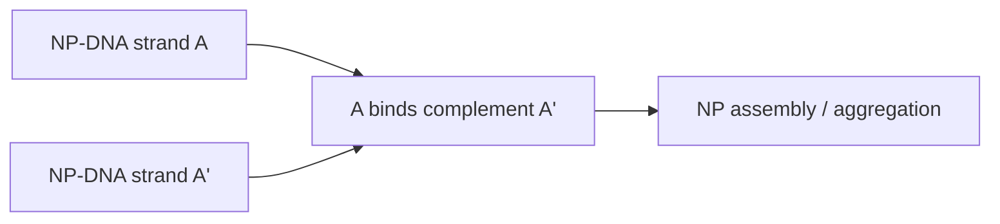
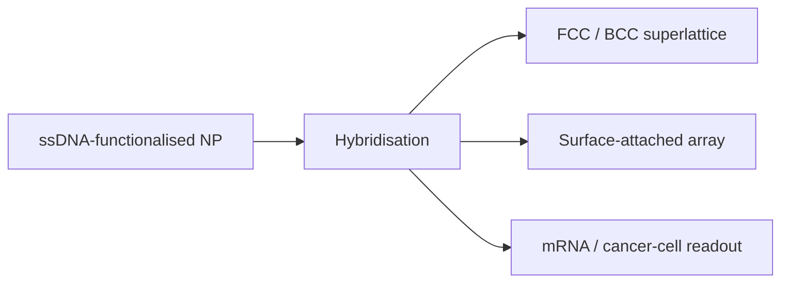

---
title: DNA-Mediated Nanoparticle Assembly
type: application
tags: [dna, nanoparticles, assembly]
lectures: [L06, L11, L12, L13]
updated: 2026-10-19
status: draft
---

# DNA-Mediated Nanoparticle Assembly

Lecture 6 briefly shows DNA as a ligand for nanoparticle assembly: nanoparticles can be functionalised with single-stranded DNA and assemble/aggregate when complementary strands bind [L6, p.24].

*Takeaway: DNA converts molecular recognition into programmable nanoparticle spacing.*

The exact DNA sequence and drawn chemistry are not legible enough to transcribe [L6, p.24].

## Lectures 11–13 extension — superlattices, surfaces and diagnostics
Lecture 11 explicitly states that DNA is programmable and can control spatial arrangement of nanoparticle superlattices, including FCC and BCC lattice examples [L11, p.7]. Lecture 12 uses DNA to attach nanoparticles on surfaces, including gold/silver growth from target-DNA binding and conductivity changes [L12, p.13]. Lecture 13 adapts DNA recognition for cancer-cell detection in blood and for [[sirna-delivery]] [L13, pp.20–22].

*Takeaway: DNA linkers support bulk superlattices, surface arrays and biomedical recognition [L11, p.7; L12, p.13; L13, pp.20–22].*
