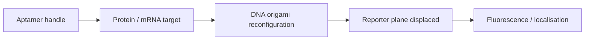

# DNA Nanorobots and DNA-Origami Diagnostics

Lecture 13 uses DNA origami for recognition and delivery devices: DNA aptamer handles recognise protein targets, a fluorescent product reports on recognition, and a reconfigurable 3D structure can localise or release a target protein [L13, p.22]. A related gold nanoparticle diagnostic scheme uses DNA/mRNA complementarity and reporter-plane displacement to detect cancer cells in blood [L13, p.20].

*Takeaway: DNA nanodevices convert molecular recognition into a structural or optical readout [L13, pp.20–22].*

## Recognition logic
For complementary nucleic-acid binding:

$$\mathrm{DNA_{probe}+mRNA_{target}\rightleftharpoons DNA{\cdot}mRNA}$$

| Symbol | Meaning | Units / notes |
|---|---|---|
| $\mathrm{DNA_{probe}}$ | immobilised or particle-bound recognition sequence | mol L$^{-1}$ |
| $\mathrm{mRNA_{target}}$ | target transcript | mol L$^{-1}$ |
| $\mathrm{DNA{\cdot}mRNA}$ | hybrid duplex | mol L$^{-1}$ |

Assumptions and limits: schematic recognition reaction. The scan states that recognising target mRNA releases fluorescence for detection of cancer cells in blood, but exact sequences are not given [L13, p.20].

## Links
Related to [[dna-origami]], [[dna-mediated-nanoparticle-assembly]], [[gold-nanoparticles]] and [[sirna-delivery]].

