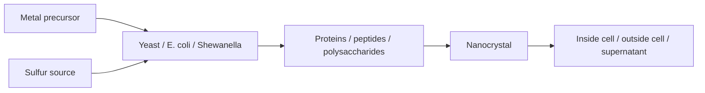

# Microbial Nanomaterial Synthesis

Microbial nanomaterial synthesis uses living cells or cell cultures as reaction environments for nanocrystal formation [L10, p.16]. The lecture contrasts conventional chemical routes, which can be energy intensive, toxic, multi-step and costly, with biogenic synthesis that offers mild conditions, green chemistry, genetically tunable properties and water-compatible biological shells [L10, p.16].

*Takeaway: microbes turn precursor uptake, metabolism and biomolecule binding into nanoscale reaction control [L10, pp.16–20].*

## Chemistry / physics
For CdS products:

$$Q= [\mathrm{Cd^{2+}}][\mathrm{S^{2-}}], \qquad Q>K_{sp}\Rightarrow \mathrm{CdS(s)}$$

| Symbol | Meaning | Units / notes |
|---|---|---|
| $Q$ | reaction quotient / ion activity approximation | concentration-squared approximation |
| $K_{sp}$ | solubility product | same activity units as $Q$ |
| $\mathrm{Cd^{2+}}$ | cadmium precursor | mol L$^{-1}$ |
| $\mathrm{S^{2-}}$ | sulfide precursor | mol L$^{-1}$ |

Assumptions: simplified precipitation condition; cellular ligands, transport and local pH mean bulk concentration is not enough to predict nucleation [L10, p.17].

## Examples
- Yeast cells synthesize intracellular and extracellular CdS nanocrystals; phytochelatin-like sulfur chemistry captures metal and supports crystal formation [L10, p.17].
- E. coli exposed to CdCl$_2$ and Na$_2$S can form CdS, but no clear correlation between free thiol amount and nanocrystal formation is seen [L10, p.17].
- Recombinant E. coli can co-express phytochelatin/metallothionein-like binding machinery and form metallic or semiconductor nanomaterials [L10, p.18].
- [[shewanella-oneidensis]] and halophilic bacteria form extracellular minerals that can be easier to separate from cells [L10, pp.18–19].

## Links
Extends [[biomineralization]] and [[controlled-nucleation-growth]] into living-cell reactors.

