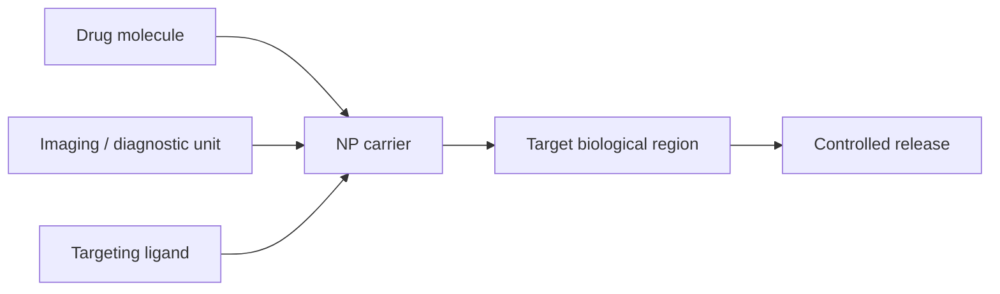
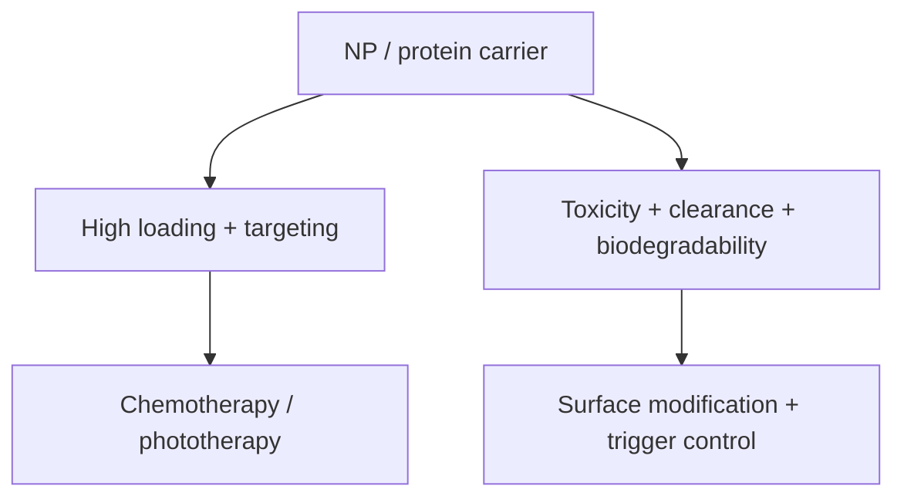

# Nanoparticle Drug Delivery

Nanoparticle-based drug delivery is introduced as a nanocompatible formulation strategy that can expand the therapeutic window when approved drugs are delivered as nanoscale carriers [L7, p.3]. Benefits listed in the notes include high surface-to-volume ratio for loading, combination of therapy and diagnostics as [[theranostics]] vehicles, targeting, controlled release, and size/material compatibility with biological mechanisms and cell-cell interactions [L7, p.3].

*Takeaway: nanocarriers integrate cargo, targeting, imaging and release in one biohybrid object [L7, p.3].*

## Chemistry / physics
Surface loading scales with particle surface area:

$$A=4\pi r^2,\qquad V=\frac{4}{3}\pi r^3,\qquad \frac{A}{V}=\frac{3}{r}$$

| Symbol | Meaning | Units / notes |
|---|---|---|
| $A$ | particle surface area | m$^2$ |
| $V$ | particle volume | m$^3$ |
| $r$ | particle radius | m, often nm |
| $A/V$ | surface-to-volume ratio | m$^{-1}$ |

Assumptions: spherical carrier, smooth surface. Real nanocarriers have ligand shells, pores and roughness. The scaling explains the lecture’s high-loading argument [L7, p.3].

## Challenges
The notes explicitly require methods to monitor absorption, distribution, metabolism, excretion and [[nanotoxicity]] (ADME/Tox) of nanomaterials in biological settings [L7, p.3]. [[microbial-nanomaterial-synthesis]] later adds biocompatibility and cargo-water-solubility as motivations for bio-based shells [L10, p.16].

## Links
Related to [[protein-engineering-drug-delivery]], [[nanoparticles]], [[x-ray-fluorescence-spectroscopy]], [[ferritin]], [[theranostics]], [[photothermal-therapy]] and [[nanotoxicity]].

## Lecture 13 extension — final nanomedicine applications
Lecture 13 makes drug delivery a final application theme: protein carriers are biocompatible, biodegradable and functionalizable; nanoparticles offer high uptake capacity, controlled synthesis, multifunctionality and stimulus-responsive systems; and integration strategies include electrostatic interactions [L13, pp.18–20]. Challenges remain degradation by proteases, liver uptake/clearance, toxicity, biodegradability and scalability for biomedical applications [L13, pp.19–21].

*Takeaway: Lecture 13 frames nanocarrier design as balancing targeting and release against biological clearance and toxicity.*
