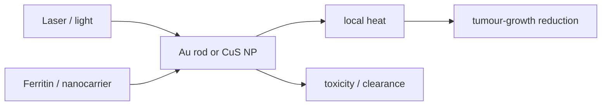

# Photothermal Therapy

## In one paragraph
Photothermal therapy uses light-absorbing nanomaterials to convert optical absorption into local heat for treatment. The notes connect CTAB/gold-nanorod chemistry with photothermal treatment and later use [[gold-nanoparticles]], [[gold-nanorods]] and ferritin/CuS nanoparticle systems as biomedical examples that reduce tumour growth under illumination [L5, p.13; L13, pp.19–20].

## The physics
Lecture 13 summarises the effect as light-to-heat conversion; a compact heat balance is:

$$Q=\eta I_{\mathrm{abs}}t,\qquad \Delta T=\frac{Q}{m c_p}$$

| Symbol | Meaning | Units / notes |
|---|---|---|
| $Q$ | heat deposited locally | J |
| $\eta$ | photothermal conversion efficiency | dimensionless |
| $I_{\mathrm{abs}}$ | absorbed optical power | W |
| $t$ | irradiation time | s |
| $\Delta T$ | temperature rise | K |
| $m$ | heated mass | kg |
| $c_p$ | heat capacity | J kg$^{-1}$ K$^{-1}$ |

Assumptions and validity limits: the equation is outside the lecture material; it neglects heat diffusion, blood perfusion, particle distribution and photodamage thresholds. The lectures give qualitative examples rather than powers or temperatures [L13, pp.19–20].

*Takeaway: photothermal design couples optical absorption to heat while still facing nanomedicine constraints [L13, pp.19–21].*

## Typical orders of magnitude
- The notes treat nanocarriers as nm-scale objects with high surface area and flexible interactions [L13, p.18].
- Gold seed particles are listed around 3–5 nm [L5, p.13].
- Thermal energies near room temperature are $k_BT\approx4.1$ pN nm (outside the lecture material).

## Connections
Related to [[localized-surface-plasmon-resonance]], [[gold-nanorods]], [[gold-nanoparticles]], [[protein-based-nanomedicine]], [[nanoparticle-drug-delivery]], [[theranostics]] and [[nanotoxicity]].
