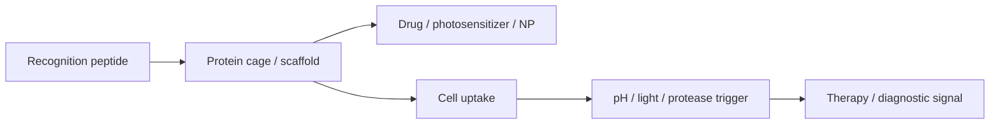

# Protein-Based Nanomedicine

Protein-based nanomedicine uses protein cages, scaffolds and recognition peptides as biocompatible carriers for drugs, imaging agents and therapeutic triggers [L13, pp.18–21]. Lecture 13 highlights protein systems because they can be defined, functionalised, biocompatible and biodegradable, while still carrying inorganic or molecular cargo [L13, p.18].

*Takeaway: proteins add targeting and degradability to nanoscale therapeutic cargo [L13, pp.18–21].*

## Examples
- Human heavy-chain ferritin with RGD peptide attached to the N-terminus for cancer recognition [L13, p.18].
- Doxorubicin loaded into ferritin by complexation with Cu, incorporation and diffusion, reducing cancer-cell growth rate [L13, p.18].
- Ferritin plus photosensitizer for photodynamic therapy and ferritin with CuS nanoparticles for [[photothermal-therapy]] [L13, p.19].
- Bacterial microcompartments that encapsulate enzymes for higher efficiency/specificity [L13, p.22].

## Release physics
Triggered release can be represented as:

$$\frac{dM_{\mathrm{rel}}}{dt}=k_{\mathrm{rel}}(M_0-M_{\mathrm{rel}})$$

| Symbol | Meaning | Units / notes |
|---|---|---|
| $M_{\mathrm{rel}}$ | released cargo amount | mol or mass |
| $t$ | time | s |
| $k_{\mathrm{rel}}$ | release rate constant | s$^{-1}$ |
| $M_0$ | total loadable cargo | mol or mass |

Assumptions and limits: outside-the-lecture first-order model. The scan states pH, protease digestion and light as triggers but does not quantify rates [L13, pp.19–20].

## Links
Related to [[ferritin]], [[protein-cages]], [[nanoparticle-drug-delivery]], [[photothermal-therapy]], [[theranostics]], [[gold-nanorods]] and [[dna-nanorobots]].

