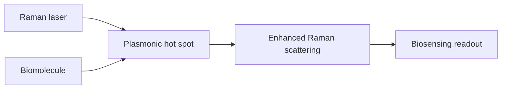

# SERS Biosensing

Surface-enhanced Raman spectroscopy (SERS) biosensing uses plasmonic hot spots to increase Raman signals from biomolecules [L10, p.22]. The lecture notes localized surface plasmons can enhance signals up to about $10^{10}$ and enable detection of biomolecules at single-molecule levels [L10, p.22].

*Takeaway: plasmonic nanogaps act as optical amplifiers for weak Raman scattering [L10, p.22].*

## Physics
$$G_{\mathrm{SERS}}\approx\left|\frac{E_{\mathrm{loc}}}{E_0}\right|^4$$

| Symbol | Meaning | Units / notes |
|---|---|---|
| $G_{\mathrm{SERS}}$ | SERS enhancement factor | dimensionless |
| $E_{\mathrm{loc}}$ | local field at molecule | V m$^{-1}$ |
| $E_0$ | incident field | V m$^{-1}$ |

Assumptions: electromagnetic enhancement model; chemical enhancement, molecular orientation and adsorption also influence measured signals.

## Links
Enabled by [[plasmonic-supercrystals]] and [[gold-nanoparticles]].

