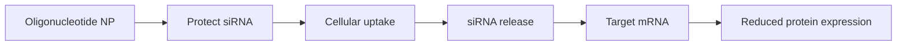

# siRNA Delivery

siRNA delivery is a Lecture 13 application where oligonucleotide nanoparticles carry siRNA into cells to silence target protein expression [L13, p.22]. The scan notes that siRNA silencing binds RNA in cells and silences protein expression, and that fake molecular blockers are needed for cellular uptake [L13, p.22].

*Takeaway: the carrier must solve protection, uptake and release before siRNA can silence a gene [L13, p.22].*

## Biology / chemistry
The functional step is sequence-specific binding:

$$\mathrm{siRNA + mRNA_{target}\rightarrow RISC\ guided\ cleavage/silencing}$$

| Symbol | Meaning | Units / notes |
|---|---|---|
| siRNA | small interfering RNA cargo | mol L$^{-1}$ |
| $\mathrm{mRNA_{target}}$ | complementary transcript | mol L$^{-1}$ |
| RISC | RNA-induced silencing complex | biological complex |

Assumptions and limits: outside-the-lecture mechanistic context. The scan only states binding to RNA in cells and silencing protein expression [L13, p.22].

## Links
Related to [[dna-origami]], [[dna-nanorobots]], [[nanoparticle-drug-delivery]] and [[protein-based-nanomedicine]].

