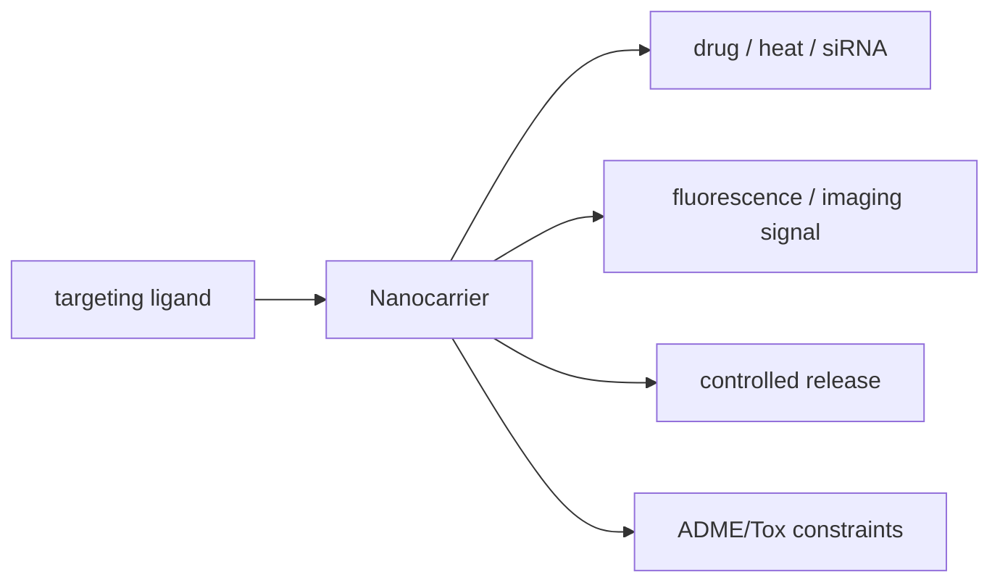

# Theranostics

## In one paragraph
Theranostics combines therapy and diagnostics in one nanocarrier or biohybrid construct. Lecture 7 explicitly lists therapy plus diagnostics as a motivation for [[nanoparticle-drug-delivery]], and lecture 13 closes the module with carriers that combine loading, targeting, imaging/recognition and triggered release [L7, p.3; L13, pp.18–22].

## The design logic
A minimal theranostic carrier has separable modules:

$$\mathrm{Carrier}=\mathrm{core}+\mathrm{cargo}+\mathrm{targeting\ ligand}+\mathrm{diagnostic\ signal}$$

| Term | Meaning | Units / notes |
|---|---|---|
| core | NP, protein cage or DNA scaffold | nm-scale object |
| cargo | drug, photosensitizer, siRNA or enzyme | mol, mass or copy number |
| targeting ligand | peptide, binder or DNA recognition sequence | surface density, nm$^{-2}$ |
| diagnostic signal | fluorescence, X-ray, Raman or optical signal | modality-dependent |

Assumptions and validity limits: this bookkeeping expression is outside the lecture material; it is not a reaction equation. The lectures ground the concept in high surface-to-volume ratio, high loading, targeting, controlled release and ADME/Tox monitoring [L7, p.3; L13, pp.18–22].

*Takeaway: theranostics is useful only if therapy, readout and biological fate are engineered together [L7, p.3; L13, pp.18–21].*

## Typical orders of magnitude
- Lecture-level quantities are qualitative: nm-scale carriers, high surface area, cargo capacity and biological compatibility [L7, p.3; L13, p.18].
- Zeta potentials beyond roughly $\pm30$ mV indicate colloidal stability and can affect delivery formulations [L6, p.21].
- Toxicity, biodegradability, liver uptake/clearance and scalability are explicit limits [L13, pp.20–21].

## Connections
Builds on [[nanoparticle-drug-delivery]], [[protein-based-nanomedicine]], [[dna-nanorobots]], [[sirna-delivery]], [[photothermal-therapy]], [[nanotoxicity]] and [[surface-charge]].
