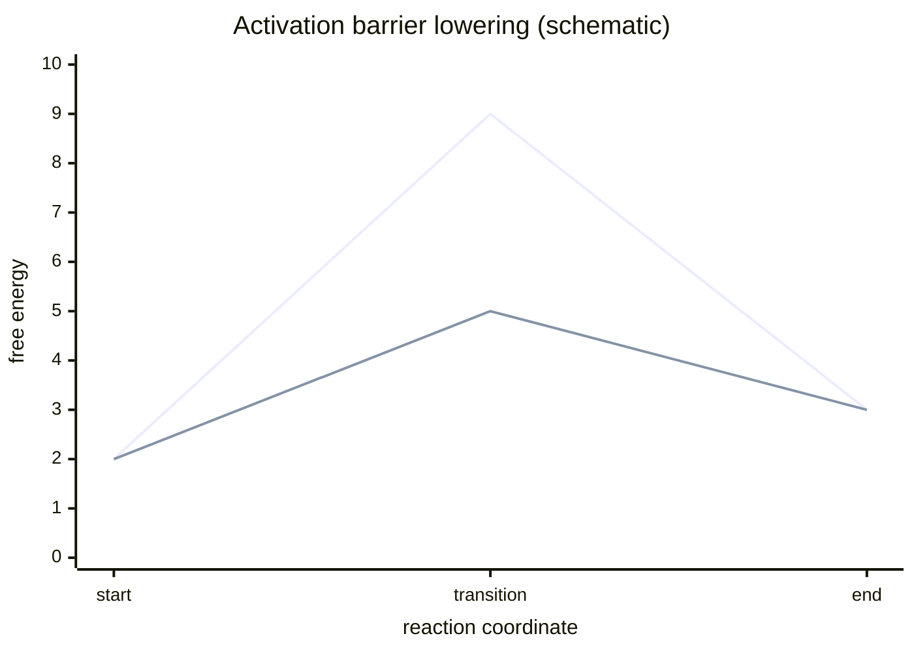

# Activation Energy

## In one paragraph
Activation energy is the barrier that must be overcome for a reaction, catalytic step or nucleation event to proceed. Lecture 2 uses it to explain how enzymes increase rates by lowering the transition-state barrier, and lecture 9 uses an Arrhenius-like expression for nucleation rate that depends on a barrier $\Delta G^\*$ [L2, p.7; L9, p.12].

## The kinetics
Lecture 2 motivates an exponential barrier dependence:

$$k\propto\exp\left(-\frac{\Delta G^{\ddagger}}{RT}\right)$$

Lecture 9 gives nucleation-rate dependence:

$$J_N=J_0\exp\left(-\frac{C\Delta G^\*}{k_BT}\right)$$

| Symbol | Meaning | Units / notes |
|---|---|---|
| $k$ | reaction rate constant | reaction-order dependent |
| $\Delta G^{\ddagger}$ | activation free energy | kJ mol$^{-1}$ |
| $R$ | gas constant | J mol$^{-1}$ K$^{-1}$ |
| $T$ | absolute temperature | K |
| $J_N$ | nucleation rate | nuclei volume$^{-1}$ time$^{-1}$ |
| $J_0$ | nucleation prefactor | same as $J_N$ |
| $C$ | handwritten proportionality factor | definition not specified in scan |
| $\Delta G^\*$ | nucleation barrier | J |
| $k_B$ | Boltzmann constant | J K$^{-1}$ |

Assumptions and validity limits: a single-barrier picture ignores multistep mechanisms and changing intermediates. Lecture 2 states catalysis lowers activation energy but does not change reaction thermodynamics; lecture 9 uses the nucleation expression qualitatively [L2, p.7; L9, p.12].

*Takeaway: reducing the barrier increases rate exponentially without necessarily changing start/end free energies [L2, p.7].*

## Typical orders of magnitude
- Activation energies are commonly reported in kJ mol$^{-1}$; lecture 2 does not provide a numerical barrier.
- At 298 K, $RT\approx2.5$ kJ mol$^{-1}$, so small barrier changes can strongly alter rates (outside the lecture material).
- Nucleation barriers are often discussed in units of $k_BT$ for single clusters; lecture 9 records $k_BT$ in the denominator [L9, p.12].

## Connections
Related to [[enzyme-catalysis]], [[rational-protein-design]], [[classical-nucleation-theory]], [[controlled-nucleation-growth]], [[surface-energy]] and [[supersaturation]].
