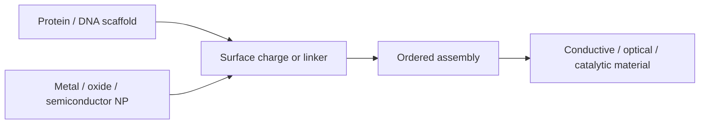

# Biohybrid Conductive Materials

Biohybrid conductive materials use biological objects such as protein containers, DNA linkers or protein crystals to place inorganic nanoparticles with optical, electrical, magnetic or catalytic function [L11, pp.1–2]. Lecture 11 frames the design as three connected steps: alter the biological surface, synthesize or load nanoparticles, then self-assemble building blocks into ordered materials [L11, p.1].

*Takeaway: the biohybrid contribution is spatial organisation; the inorganic contribution is functional response [L11, pp.1–2].*

## Design levers
- **[[surface-charge|Surface charge]]:** Rosetta-guided substitution can make protein containers positive, negative or patchy, changing crystal contacts [L11, pp.2–3].
- **Nanoparticle identity:** metals give optical/electrical/catalytic properties, metal alloys magnetic/catalytic properties, metal oxides magnetic/catalytic properties and semiconductors optical/electrical properties [L11, p.2].
- **Assembly condition:** ionic strength, concentration and [[hydrophobic-effect|hydrophobic]] [[ligand-shell|ligand shells]] and [[van-der-waals-interactions]] decide whether the product disperses, aggregates or crystallises [L11, pp.1–2].

## Physics
At fixed building-block size, conductivity or optical coupling requires close spacing:

$$\Gamma(d)\propto \exp\!\left(-\frac{d}{\lambda}\right)$$

| Symbol | Meaning | Units / notes |
|---|---|---|
| $\Gamma$ | coupling strength between neighbouring NPs | arbitrary or s$^{-1}$ |
| $d$ | interparticle gap | nm |
| $\lambda$ | decay length for near-field/tunnelling-like coupling | nm |

Assumptions and limits: this exponential expression is outside-the-lecture schematic context. It captures why thin ligands are desired in L11: shorter distances increase optical, catalytic or electronic interactions [L11, p.4].

## Links
Implemented through [[protein-crystal-nanoparticle-superlattices]], [[dna-mediated-nanoparticle-assembly]], [[gold-nanoparticles]], [[gold-nanorods]] and [[plasmon-exciton-coupling]].

