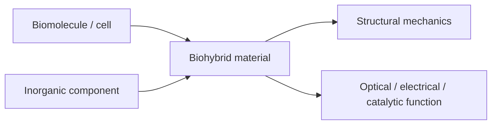
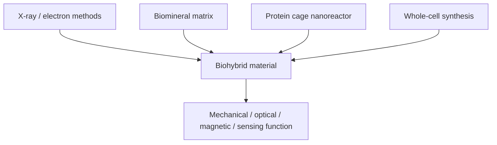
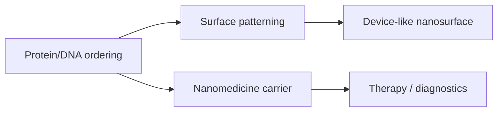

---
title: Biohybrid Materials
type: concept
tags: [biohybrid, design-principle]
lectures: [L01, L05, L07, L09, L10, L11, L12, L13]
updated: 2026-10-19
status: draft
---

# Biohybrid Materials

Biohybrid materials consist of biocomponents such as [[biomolecules]], cells or tissues combined with other components such as synthetic polymers, ceramics, metals or metal oxides [L1, p.1]. In the lecture, the motivation is complementary: biomolecules offer defined 3D structure, atomic precision, repair/regeneration and softness, while inorganic components offer optical, electrical, magnetic or catalytic properties but are harder to assemble precisely [L1, p.1].

*Takeaway: biohybrids are designed by matching biological structure with non-biological function.*

## Design assumptions and limits
- Natural biological materials in the notes are mostly structural and mechanical; artificial biohybrids aim for new functions [L1, p.1].
- Biohybrid design is constrained by compatibility: pH, salt, temperature and solvent must not denature the biomolecule.
- Typical length scales in this module start at molecular/protein dimensions, roughly nm to tens of nm (outside the lecture material).

## Links
Introduced in [[L01]]; connected to [[proteins]], [[dna-rna]], [[protein-cages]] and [[protein-crystals]].

## Lecture 5 extension — inorganic nanoparticle component
Lecture 5 supplies the inorganic side of biohybrid materials: [[nanoparticles]] can contribute plasmonic, magnetic, fluorescent or catalytic properties, but require [[nanoparticle-stabilization]] and [[nanoparticle-ligands]] to remain useful in solution [L5, pp.6,8–14].

## Lectures 7–10 extension — measured and living hybrids
Lectures 7–10 make the biohybrid idea more literal: X-ray and electron methods measure hybrid samples, natural [[biominerals]] show how biological matrices integrate inorganic phases, [[ferritin]] and [[apoferritin]] confine reactions in protein cages, and microbes or phage templates synthesize and pattern inorganic nanoparticles [L7, pp.1–4; L9, pp.12–15; L10, pp.16–20].

*Takeaway: biohybrid design now includes natural mineral composites, protein nanoreactors and living-cell synthesis routes.*

## Lectures 11–13 extension — from assemblies to applications
The final ingest adds the engineered end of the module: [[biohybrid-conductive-materials]] use protein crystals and DNA to order nanoparticle function; [[self-assembled-monolayers]], [[langmuir-blodgett-films]] and lithography organise surfaces; and [[protein-based-nanomedicine]] converts cages, gold nanomaterials and DNA origami into therapy and diagnostics [L11, pp.1–7; L12, pp.8–17; L13, pp.18–22].

*Takeaway: the final lectures complete the path from biomolecular structure to assembled materials and biomedical use.*
