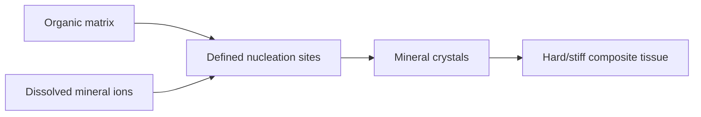

# Biomineralization

Biomineralization is the process by which living organisms produce minerals to harden or stiffen existing tissues [L9, p.12]. The lecture examples are bone, teeth and shells, where an organic matrix such as collagen or protein scaffolds directs inorganic phases such as calcium phosphate or calcium carbonate [L7, p.4; L9, p.12].

*Takeaway: the biological matrix localizes nucleation and shapes mineral growth [L9, pp.12–13].*

## Chemistry / physics
Generic mineral precipitation is driven by supersaturation:

$$S=\frac{IAP}{K_{sp}}$$

| Symbol | Meaning | Units / notes |
|---|---|---|
| $S$ | supersaturation ratio | dimensionless |
| $IAP$ | ion activity product of mineral ions | depends on mineral stoichiometry |
| $K_{sp}$ | solubility product | same activity units as $IAP$ |

Assumptions: activity-based equilibrium model; organisms add confinement, matrices, proteins and kinetics, so $S>1$ is necessary but not sufficient to predict mineral shape [L9, pp.12–13].

## Mechanisms from the lecture
1. Control crystal nucleation by providing nucleation sites [L9, p.13].
2. Control crystal growth after nucleation to regulate size and shape [L9, p.13].
3. Confine crystallization in pores or compartments [L9, p.13].
4. Form composites of inorganic mineral and organic matrix [L9, p.13].
5. Assemble single biocomponents into larger aggregates [L9, p.13].

## Links
Produces [[biominerals]] and inspires [[nanoparticle-synthesis-in-nanoreactors]], [[ferritin]] and [[microbial-nanomaterial-synthesis]].

