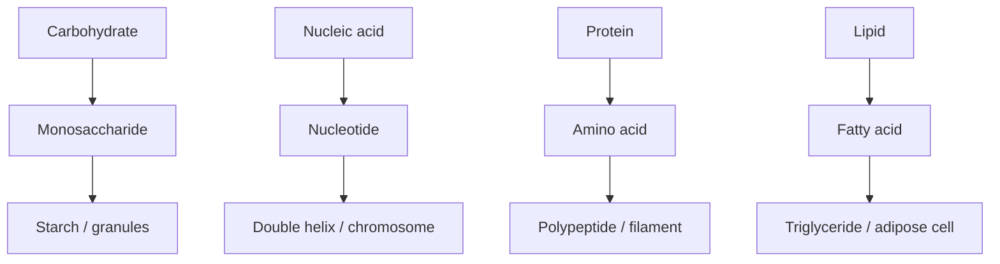

---
title: Biomolecules
type: concept
tags: [biomolecules, hierarchy]
lectures: [L01]
updated: 2026-10-19
status: draft
---

# Biomolecules

The lecture table groups biomolecules into monomers, polymers and cellular structures: carbohydrates form monosaccharides, starch and chloroplast granules; nucleic acids form nucleotides, double-helix [[dna-rna]] and chromosomes; [[proteins]] form amino acids, polypeptides and tubulin-like filaments; lipids form fatty acids, triglycerides and adipose cells [L1, p.2].

*Takeaway: the lecture frames biology as hierarchical self-assembly from monomer to cellular object.*

## Key chemistry / physics
Biomolecules in the notes are built from a limited element set, mainly C/H/N/O/S [L1, p.1]. Their interactions are weak individually—hydrogen bonds, electrostatics, hydrophobic effects and van der Waals contacts—but many contacts together stabilise structures.

## Links
Biomolecules are the biological half of [[biohybrid-materials]] and include [[amino-acids-peptides]], [[protein-structure]] and [[dna-rna]].
