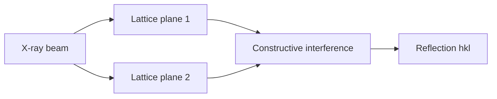

---
title: Bragg Law
type: concept
tags: [diffraction, bragg, x-ray]
lectures: [L03]
updated: 2026-10-19
status: draft
---

# Bragg Law

Bragg's law describes constructive interference from crystal lattice planes when the path difference between reflected waves is an integer multiple of the wavelength [L3, p.21].

$$
2d\sin\theta = n\lambda
$$

| Symbol | Meaning | Units |
|---|---|---|
| $d$ | plane spacing | nm or Å |
| $\theta$ | incident/reflection angle | degrees or radians |
| $n$ | diffraction order | dimensionless integer |
| $\lambda$ | X-ray wavelength | nm or Å |

*Takeaway: diffraction spots report periodic spacings in the protein crystal.*

## Links
Used by [[x-ray-diffraction]], [[reciprocal-space-fourier-transform]] and [[protein-crystallography]].
