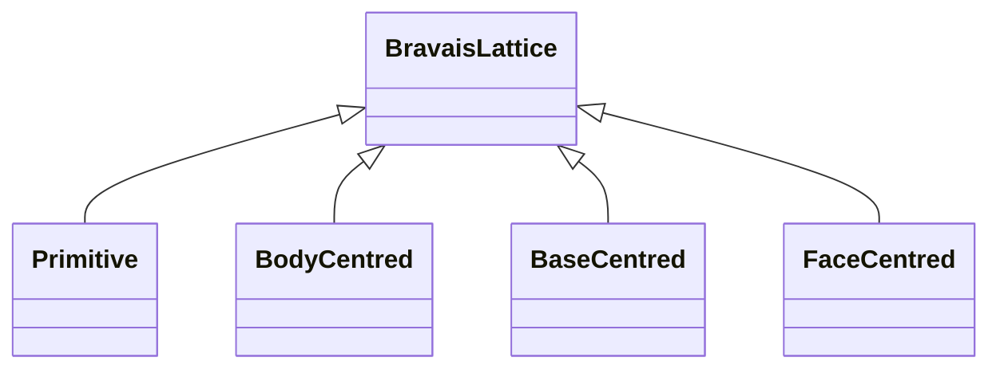

---
title: Bravais Lattices
type: concept
tags: [lattice, unit-cell, crystallography]
lectures: [L03]
updated: 2026-10-19
status: draft
---

# Bravais Lattices

A lattice is defined by a vector triple; the lecture lists 14 Bravais lattices with centring types P primitive, I body-centred, C base-centred and F face-centred [L3, p.20]. A Bravais lattice is one in which the arrangement around every lattice point is identical and the lattice is symmetric by translation [L3, p.20].

*Takeaway: centring tells where equivalent lattice points sit inside the unit cell.*

## Crystal systems noted
Cubic, tetragonal, orthorhombic, monoclinic, hexagonal, rhombohedral and triclinic systems are drawn with constraints on $a,b,c$ and $\alpha,\beta,\gamma$ [L3, p.15].

## Links
Part of [[crystallographic-symmetry]] and [[protein-crystallography]].
