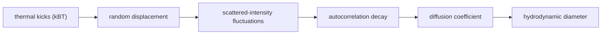

# Brownian Motion

## In one paragraph
Brownian motion is the random thermal motion of particles in solution. Lecture 6 uses Brownian-motion-driven intensity fluctuations as the basis of [[dynamic-light-scattering]], converting autocorrelation decay into diffusion and hydrodynamic diameter through the [[stokes-einstein-equation]] [L6, pp.17–20].

## The physics
For one-dimensional diffusion, the mean-square displacement is:

$$\langle x^2\rangle=2Dt$$

and lecture 6 uses:

$$D_p=\frac{k_BT}{3\pi\eta x_{h,t}}$$

| Symbol | Meaning | Units / notes |
|---|---|---|
| $\langle x^2\rangle$ | mean-square displacement along one axis | m$^2$ |
| $D$ or $D_p$ | diffusion coefficient | m$^2$ s$^{-1}$ |
| $t$ | lag time | s |
| $k_B$ | Boltzmann constant | J K$^{-1}$ |
| $T$ | absolute temperature | K |
| $\eta$ | dynamic viscosity | Pa s |
| $x_{h,t}$ | translational hydrodynamic diameter | m |

Assumptions and validity limits: the mean-square relation is outside the lecture material; the Stokes-Einstein equation is in the lecture and assumes dilute Brownian particles in a continuum solvent. Dust, bubbles, sedimentation, aggregation and wrong concentration can spoil DLS [L6, pp.17,19].

*Takeaway: DLS measures size indirectly by timing Brownian fluctuations [L6, pp.18–20].*

## Typical orders of magnitude
- Diffusion coefficients are in m$^2$ s$^{-1}$; nm particles diffuse faster than larger particles.
- DLS correlation amplitudes should be high and repeatable; lecture 6 flags amplitude above roughly 0.8 as good [L6, pp.17,19].
- Hydrodynamic size includes the particle plus solvent/ligand shell [L6, pp.17–20].

## Connections
Connects [[dynamic-light-scattering]], [[stokes-einstein-equation]], [[polydispersity-index]], [[nanoparticles]] and [[ligand-shell]].
