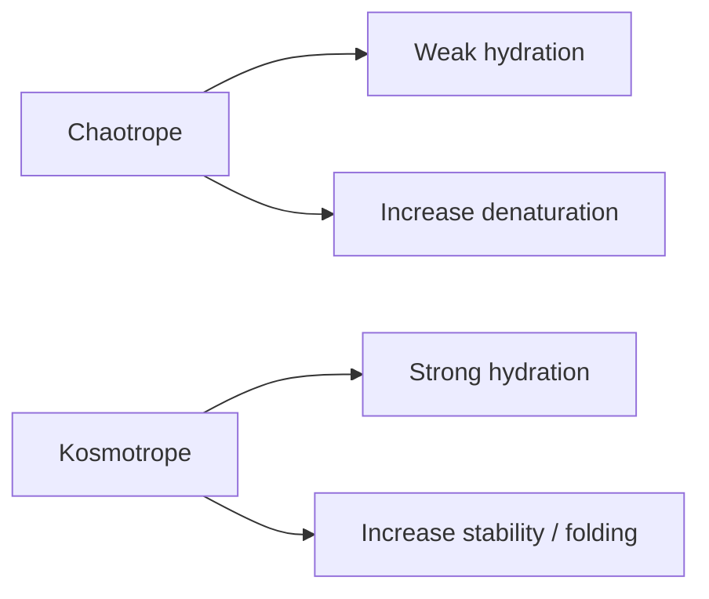

---
title: Chaotropic and Kosmotropic Ions
type: concept
tags: [ions, hofmeister, solubility]
lectures: [L03]
updated: 2026-10-19
status: draft
---

# Chaotropic and Kosmotropic Ions

Lecture 3 defines chaotropic ions as preferring weakly H-bonded surfaces: they are large, singly charged, low charge-density, weakly hydrated ions such as SCN$^-$; they can increase denaturation/unfolding and stabilise salting-in behaviour [L3, p.25]. Kosmotropic ions prefer bulk hydration, are small or multiply charged, high charge-density, strongly hydrated ions such as SO$_4^{2-}$, and enhance the structure of water [L3, p.25].

*Takeaway: ion hydration controls whether proteins are stabilised, destabilised, salted in or salted out.*

## Links
Explains [[salting-in-salting-out]] and affects [[protein-folding-thermodynamics]] and [[protein-crystallization-phase-diagram]].
