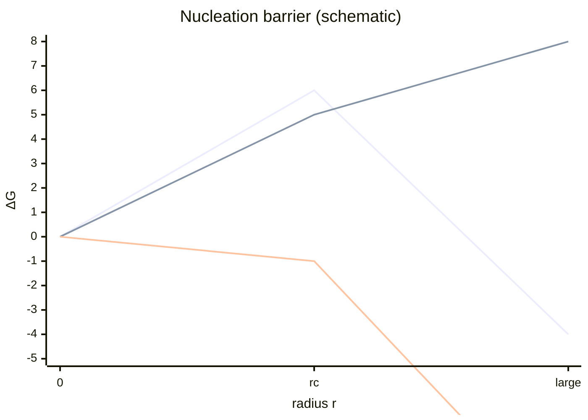

# Classical Nucleation Theory

Classical nucleation theory balances positive [[surface-energy]] against a negative bulk term from [[supersaturation]] to explain a critical cluster size $r_c$ and [[activation-energy|barrier]] [L5, p.7].

$$\Delta G(r)=4\pi r^2\gamma+\frac{4}{3}\pi r^3\Delta G_v$$

| Symbol | Meaning | Units / notes |
|---|---|---|
| $\Delta G$ | cluster formation free energy | J |
| $\gamma$ | surface energy | J m$^{-2}$ |
| $\Delta G_v$ | bulk free-energy change per volume | J m$^{-3}$ |
| $r_c$ | critical cluster radius | m |

*Takeaway: subcritical nuclei dissolve, supercritical nuclei grow [L5, p.7].*

