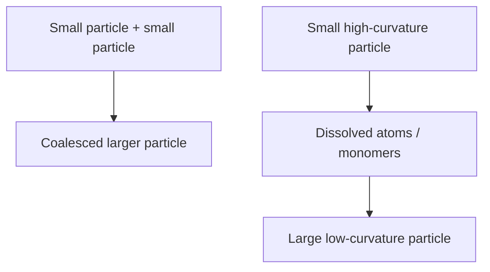

---
title: Coalescence and Ostwald Ripening
type: concept
tags: [nanoparticles, aging, surface-energy]
lectures: [L05]
updated: 2026-10-19
status: draft
---

# Coalescence and Ostwald Ripening

Coalescence merges two particles after collision. Ostwald ripening transfers atoms from smaller, higher-curvature particles to larger particles, so smaller particles dissolve at the expense of larger ones [L5, p.8].

*Takeaway: both pathways reduce surface energy but alter the size distribution.*

Parameters listed are concentration, supersaturation, temperature, precursor and surface energy [L5, p.8].

