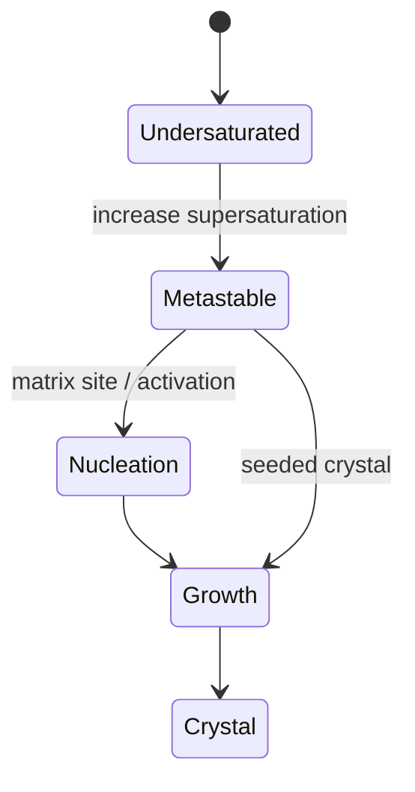

# Controlled Nucleation and Growth

Controlled nucleation and growth describes how organisms regulate mineral formation by selecting nucleation sites, modulating supersaturation, confining reaction volumes and separating diffusion-controlled from kinetically controlled regimes [L9, pp.12–13].

*Takeaway: biological control often keeps solutions metastable until a template triggers nucleation [L9, pp.12–13].*

## Equations
The lecture records:

$$J_N=J_0\exp\!\left(-\frac{C\,\Delta G^\*}{k_BT}\right), \qquad J_W=kS^x$$

| Symbol | Meaning | Units / notes |
|---|---|---|
| $J_N$ | nucleation rate | nuclei volume$^{-1}$ time$^{-1}$ |
| $J_0$ | kinetic prefactor | same as $J_N$ |
| $C$ | handwritten proportionality factor | unspecified |
| $\Delta G^\*$ | nucleation barrier | J |
| $k_B$ | Boltzmann constant | J K$^{-1}$ |
| $T$ | temperature | K |
| $J_W$ | growth rate | model-dependent |
| $S$ | supersaturation | dimensionless |
| $x$ | empirical exponent | dimensionless |

Assumptions: the equations are qualitative lecture formulas; exact constants depend on mineral, solution and template.

## Links
Extends [[classical-nucleation-theory]] and underpins [[biomineralization]], [[ferritin]] and [[microbial-nanomaterial-synthesis]].

