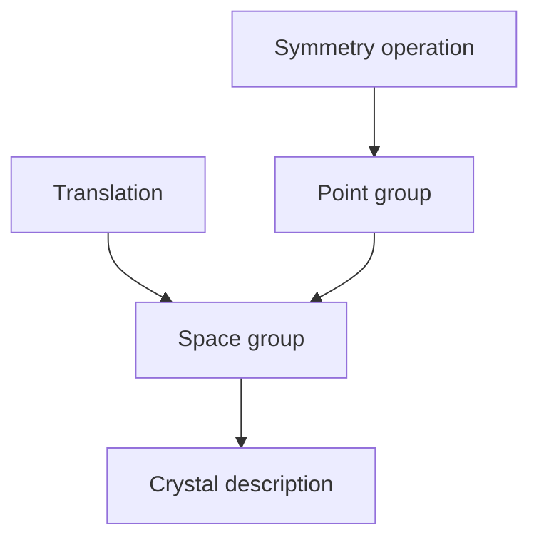

---
title: Crystallographic Symmetry
type: concept
tags: [symmetry, crystallography]
lectures: [L03]
updated: 2026-10-19
status: draft
---

# Crystallographic Symmetry

The lecture lists point-symmetry elements: identity, rotation axes $C_n$, mirror planes, inversion centre, rotoinversion and rotary reflection; space symmetry adds glide planes and screw axes [L3, p.16]. Hermann–Mauguin notation records identity, rotation axes, mirror planes, inversion centres and rotations [L3, p.16].

*Takeaway: protein-crystal symmetry is point symmetry plus translational lattice symmetry.*

## Key relation
For an $n$-fold rotation:

$$
\alpha = \frac{360^\circ}{n}
$$

| Symbol | Meaning | Units |
|---|---|---|
| $\alpha$ | rotation angle | degrees |
| $n$ | order of rotation axis | dimensionless |

## Links
Used by [[bravais-lattices]], [[protein-crystals]] and [[protein-crystallography]].
