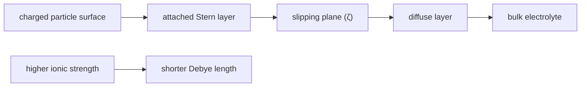

# Debye Length and Slipping Plane

## In one paragraph
The Debye length is the electrostatic screening length around a charged surface, while the slipping plane is the hydrodynamic boundary where liquid moves with the particle on one side and as bulk solution on the other. Lecture 5 introduces double-layer screening, and lecture 6 defines zeta potential as the potential at the slipping plane [L5, pp.9–10; L6, p.21].

## The physics
The lecture gives the Debye-length form:

$$\kappa^{-1}=\sqrt{\frac{\varepsilon\varepsilon_0 k_BT}{e^2\sum_i z_i^2c_i}}$$

| Symbol | Meaning | Units / notes |
|---|---|---|
| $\kappa^{-1}$ | Debye length | m, often nm |
| $\varepsilon\varepsilon_0$ | solvent permittivity | F m$^{-1}$ |
| $k_B$ | Boltzmann constant | J K$^{-1}$ |
| $T$ | absolute temperature | K |
| $e$ | elementary charge | C |
| $z_i$ | ion valence | dimensionless |
| $c_i$ | number concentration of ion $i$ | m$^{-3}$ |

Assumptions and validity limits: continuum solvent, dilute electrolyte and mean-field screening. The slipping plane is not the bare solid surface; therefore zeta potential is an effective mobility-related potential, not necessarily the true surface potential [L6, p.21].

*Takeaway: ions screen surface charge over the Debye length, but electrophoresis reads the slipping-plane potential [L5, p.10; L6, p.21].*

## Typical orders of magnitude
- Debye lengths are nm-scale for common aqueous electrolytes (outside the lecture material).
- Stable dispersions are associated with $\zeta<-30$ mV or $\zeta>+30$ mV; near 0 mV stability decreases [L6, p.21].
- Increasing ionic strength compresses the double layer, reducing electrostatic repulsion [L5, pp.9–10].

## Connections
Related to [[electrical-double-layer]], [[zeta-potential]], [[surface-charge]], [[isoelectric-point]], [[electrophoretic-light-scattering]] and [[nanoparticle-stabilization]].
