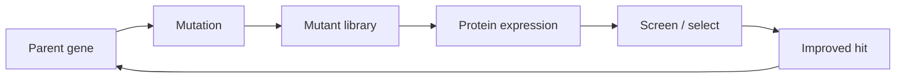

---
title: Directed Evolution
type: concept
tags: [evolution, screening, protein-engineering]
lectures: [L02]
updated: 2026-10-19
status: draft
---

# Directed Evolution

Directed evolution iterates mutation and selection to evolve containers or enzymes with desired properties by introducing genetic diversity into a population and selecting variants with improved function [L2, pp.7,12].

*Takeaway: directed evolution converts molecular design into a search over genotype-function space.*

## Parameters
Selection can be changed by host, temperature, pH, aeration and induction strength [L2, p.7]. It is powerful when structure-function rules are incomplete.

## Links
Depends on [[recombinant-protein-production]] and [[genetic-code-central-dogma]]; complements [[rational-protein-design]].
