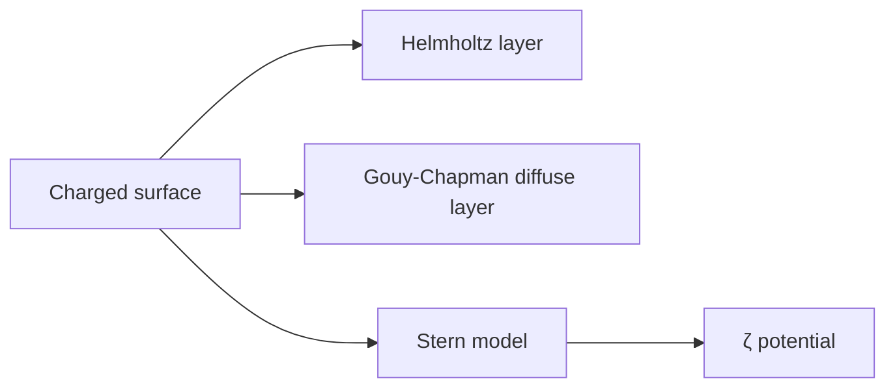

# Electrical Double Layer

The electrical double layer (elektrische Doppelschicht) is the ionic structure at a [[surface-charge|charged surface]]/electrolyte interface [L5, p.9]. Helmholtz, Gouy–Chapman and Stern models are compared: rigid layer, diffuse layer and compact-plus-diffuse layer [L5, p.9].

$$\kappa^{-1}=\sqrt{\frac{\varepsilon\varepsilon_0 k_BT}{e^2\sum_i z_i^2c_i}}$$

| Symbol | Meaning | Units / notes |
|---|---|---|
| $\kappa^{-1}$ | Debye length | m, often nm |
| $\varepsilon\varepsilon_0$ | permittivity | F m$^{-1}$ |
| $z_i,c_i$ | ion valence and concentration | dimensionless; m$^{-3}$ |

*Takeaway: [[surface-charge]] is screened over the [[debye-length-slipping-plane|Debye length]] [L5, p.10].*

