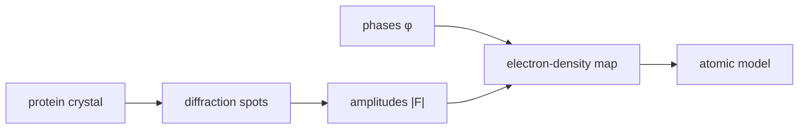

# Electron Density

## In one paragraph
Electron density is the real-space map of where electrons are located in a crystal; protein crystallography fits an atomic model into this map. Lecture 3 derives electron density from reciprocal-space reflections and structure factors, while lecture 4 explains that measured intensities provide amplitudes but phases must be recovered before the map is interpretable [L3, pp.21–22; L4, p.1].

## The physics
The lecture writes electron density as a Fourier synthesis:

$$\rho(\mathbf{x})=\frac{1}{V}\sum_{hkl}|F_{hkl}|\exp(i\phi_{hkl})\exp\left(-2\pi i\,\mathbf{h}\cdot\mathbf{x}\right)$$

| Symbol | Meaning | Units / notes |
|---|---|---|
| $\rho(\mathbf{x})$ | electron density at position $\mathbf{x}$ | e nm$^{-3}$ |
| $V$ | unit-cell volume | nm$^3$ |
| $F_{hkl}$ | structure factor for reflection $hkl$ | complex amplitude |
| $|F_{hkl}|$ | amplitude inferred from intensity | arbitrary diffraction units |
| $\phi_{hkl}$ | phase angle | rad |
| $\mathbf{h}$ | reciprocal-lattice vector | nm$^{-1}$ |
| $\mathbf{x}$ | real-space coordinate | nm |

Assumptions and validity limits: ordered crystal, adequate completeness and successful phasing. Detectors measure $I_h\propto|F_h|^2$ but lose $\phi_h$, creating the [[phase-problem]] [L4, p.1]. Resolution, disorder, radiation damage and model bias limit interpretation [L4, pp.1–2].

*Takeaway: electron density needs both measured amplitudes and recovered phases [L3, p.22; L4, p.1].*

## Typical orders of magnitude
- X-ray wavelengths and interatomic distances are Å-scale; lecture 4 compares sub-Å resolution with a 1.54 Å C–C bond [L3, p.17; L4, p.2].
- Electron density units are commonly e Å$^{-3}$ or e nm$^{-3}$ (outside the lecture material).
- Lower numerical resolution values mean finer structural detail [L4, p.2].

## Connections
Connects [[protein-crystallography]], [[x-ray-diffraction]], [[reciprocal-space-fourier-transform]], [[structure-factor]], [[phase-problem]] and [[molecular-replacement]].
