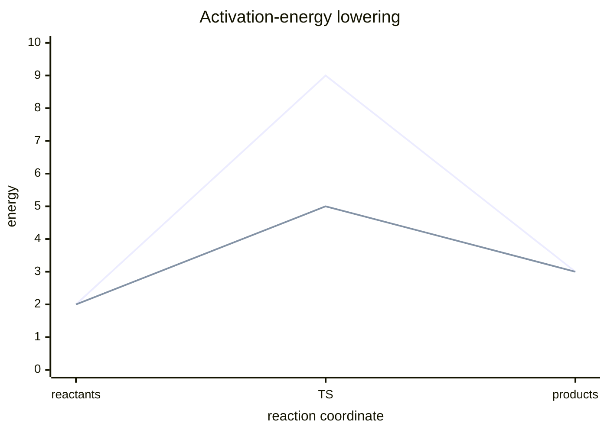

# Enzyme Catalysis

Enzymes are catalysts with specific active-site arrangements of amino acids; substrates bind to the active site, products are formed, and one enzyme molecule can turn over many substrate molecules per unit time [L2, p.7]. The notes define catalysis as lowering [[activation-energy]], not changing reaction thermodynamics [L2, p.7].

$$
k \propto \exp\left(-\frac{\Delta G^{\ddagger}}{RT}\right)
$$

| Symbol | Meaning | Units |
|---|---|---|
| $k$ | rate constant | reaction-order dependent |
| $\Delta G^{\ddagger}$ | activation free energy | kJ mol$^{-1}$ |
| $R$ | gas constant | J mol$^{-1}$ K$^{-1}$ |
| $T$ | absolute temperature | K |

*Takeaway: a designed active site should stabilise the transition state enough to lower the barrier.*

## Links
Introduced in [[L02]] and redesigned through [[rational-protein-design]], [[rosetta-protein-design]] and [[directed-evolution]].
