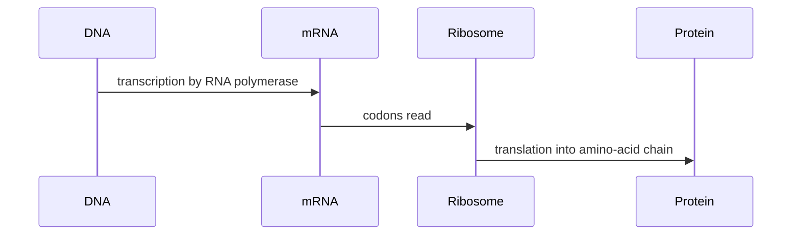

---
title: Genetic Code and Central Dogma
type: concept
tags: [dna, rna, translation]
lectures: [L01]
updated: 2026-10-19
status: draft
---

# Genetic Code and Central Dogma

The lecture draws the biosynthetic pathway for protein synthesis: DNA is transcribed to RNA, and mRNA is translated by ribosomes into protein [L1, p.3]. It also asks why the genetic code is degenerate: several codon triplets can encode the same amino acid [L1, p.3].

*Takeaway: genetic sequence is converted into protein sequence through RNA and codons.*

## Key chemistry / physics
A codon is a three-base RNA word. With four bases, the maximum number of codons is:

$$
N = 4^3 = 64
$$

| Symbol | Meaning | Units |
|---|---|---|
| $N$ | possible codons | dimensionless |
| $4$ | number of nucleotide types | dimensionless |
| $3$ | bases per codon | dimensionless |

The lecture lists advantages of degeneracy: minimising error consequences, redundancy, providing buffers and permitting translational control [L1, p.3].

## Links
Supports [[recombinant-protein-production]] and [[directed-evolution]].
