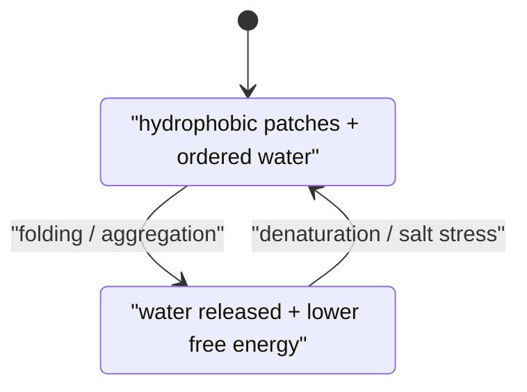

# Hydrophobic Effect

## In one paragraph
The hydrophobic effect is the water-mediated tendency of nonpolar surfaces to become buried together. Lecture 1 uses it to explain protein folding: hydrophobic residues exposed to water order nearby water, and folding releases those waters for an entropic gain; lecture 3 uses exposed hydrophobic patches in salting out, and lecture 11 notes hydrophobic ligands as part of nanoparticle assembly behaviour [L1, p.3; L3, p.23; L11, pp.1–2].

## The thermodynamics
Lecture 1 gives folding in terms of Gibbs free energy:

$$\Delta G=\Delta H-T\Delta S$$

| Symbol | Meaning | Units / notes |
|---|---|---|
| $\Delta G$ | folding/association free energy | kJ mol$^{-1}$ |
| $\Delta H$ | enthalpy from H-bonds, van der Waals and electrostatics | kJ mol$^{-1}$ |
| $T$ | absolute temperature | K |
| $\Delta S$ | entropy change, including water entropy | J mol$^{-1}$ K$^{-1}$ |

Assumptions and validity limits: the lecture presents a schematic folded/unfolded picture. Real folding can include intermediates, aggregation and sequence-specific interactions. The hydrophobic effect is not a covalent attraction between nonpolar groups; it is largely the free-energy gain from releasing ordered water [L1, p.3].

*Takeaway: burying nonpolar area can lower free energy by increasing water entropy [L1, p.3].*

## Typical orders of magnitude
- Protein folding free energies are commonly a few to tens of kJ mol$^{-1}$ (outside the lecture material).
- Individual weak interactions are around the $k_BT$ to few-$k_BT$ scale, but many contacts act collectively (outside the lecture material).
- Salting out removes hydration layers and exposes hydrophobic patches, causing aggregation [L3, p.23].

## Connections
Connects [[protein-folding-thermodynamics]], [[salting-in-salting-out]], [[hydrophobic-interaction-chromatography]], [[van-der-waals-interactions]], [[ligand-shell]] and [[biohybrid-conductive-materials]].
