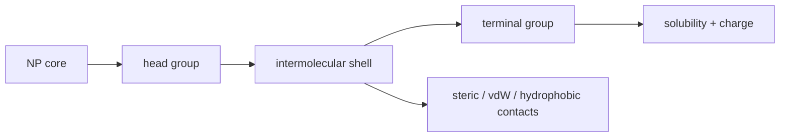

# Ligand Shell

## In one paragraph
A ligand shell is the molecular layer surrounding a nanoparticle core. Lecture 5 draws ligands as head group, intermolecular shell region and terminal group, and states that ligands control stability, solubility, accessibility and interparticle interactions; lectures 6 and 11 reuse this surface layer for hydrodynamic sizing, DNA attachment and assembly [L5, pp.13–14; L6, pp.17–24; L11, pp.1–7].

## The surface accounting
For a spherical nanoparticle, ligand surface density can be written as:

$$\Gamma=\frac{N_{\mathrm{lig}}}{4\pi r^2}$$

| Symbol | Meaning | Units / notes |
|---|---|---|
| $\Gamma$ | ligand surface density | nm$^{-2}$ or m$^{-2}$ |
| $N_{\mathrm{lig}}$ | number of ligands on one particle | dimensionless |
| $r$ | nanoparticle core radius | nm or m |

Assumptions and validity limits: this equation is outside the lecture material; it assumes a spherical core and uniform coverage. Real shells have defects, mixed ligands, exchange, compression and solvent swelling. Lecture 5 gives qualitative examples: citrate, CTAB, thiols, PEG, alkyl chains and polymers [L5, p.14].

*Takeaway: the ligand shell translates inorganic core properties into colloidal and biological behaviour [L5, p.14].*

## Typical orders of magnitude
- Ligand shells are drawn as nanometre-scale regions around nanoparticle cores [L5, p.14].
- Hydrodynamic diameter measured by DLS includes core plus ligand/solvent layer [L6, pp.17–20].
- Surface chemistry controls whether particles remain dispersed, aggregate or assemble into ordered lattices [L5, pp.8–10; L11, pp.1–7].

## Connections
Connects [[nanoparticle-ligands]], [[ligand-exchange]], [[steric-stabilization]], [[surface-charge]], [[hydrophobic-effect]], [[van-der-waals-interactions]], [[brownian-motion]] and [[nanotoxicity]].
