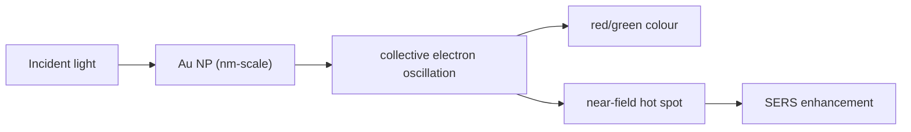

# Localized Surface Plasmon Resonance

## In one paragraph
Localized surface plasmon resonance (LSPR) is the collective oscillation of conduction electrons in a metal nanoparticle driven by incident light. In the lectures it explains why citrate-stabilised [[gold-nanoparticles]] have strong colour, why ordered Au supercrystals generate hot spots for [[sers-biosensing]], and why gold nanomaterials are useful in coupling and medicine [L5, p.11; L10, pp.21–22; L11, p.6; L13, p.20].

## The physics
For a small spherical metal particle, a common resonance condition is:

$$\mathrm{Re}\{\varepsilon_m(\omega)\}\approx -2\varepsilon_d$$

| Symbol | Meaning | Units / notes |
|---|---|---|
| $\varepsilon_m(\omega)$ | metal dielectric function | dimensionless |
| $\omega$ | light angular frequency | rad s$^{-1}$ |
| $\varepsilon_d$ | surrounding-medium dielectric constant | dimensionless |

Assumptions and validity limits: this condition is outside the lecture material; it is the quasistatic sphere limit and ignores nonspherical geometry, damping, aggregation and retardation. The lecture-level claims are that Au NP colour comes from localized plasmons and that hot spots can enhance Raman signals up to about $10^{10}$ [L5, p.11; L10, p.22].

*Takeaway: LSPR turns Au nanoparticle size, spacing and environment into colour, hot spots and optical function [L5, p.11; L10, p.22].*

## Typical orders of magnitude
- Lecture examples include 3–5 nm Au seeds and an Au product around 7 nm [L5, p.13; L11, p.4].
- Raman enhancement in plasmonic hot spots is noted as up to about $10^{10}$ [L10, p.22].
- Numerical resonance wavelengths are not given in the scans.

## Connections
LSPR connects [[gold-nanoparticles]], [[gold-nanorods]], [[plasmonic-supercrystals]], [[plasmon-exciton-coupling]], [[sers-biosensing]], [[photothermal-therapy]] and [[nanotoxicity]].
