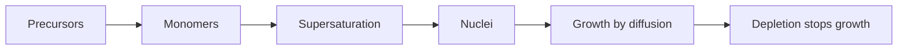

# Nanoparticle Growth

Nanoparticle growth begins with dissolved precursors, monomers generated by chemical reaction, [[supersaturation]], nucleation, diffusion-limited growth and monomer depletion below the solubility limit [L5, p.6].

*Takeaway: separating nucleation from growth narrows particle size.*

Bottom-up synthesis must stop crystallisation at the nanoparticle scale [L5, p.6].

