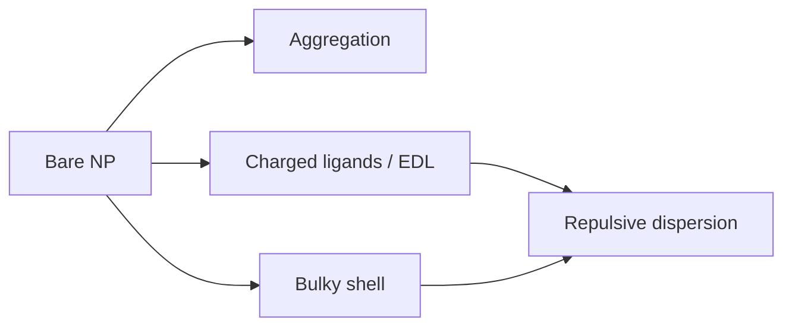

---
title: Nanoparticle Stabilization
type: concept
tags: [nanoparticles, colloids, stability]
lectures: [L05, L06]
updated: 2026-10-19
status: draft
---

# Nanoparticle Stabilization

Nanoparticle stabilisation prevents aggregation despite the drive to reduce surface energy [L5, p.8]. The lecture distinguishes charged-ligand/electrostatic stabilisation from bulky-molecule/steric stabilisation [L5, pp.8–10].

*Takeaway: stability is engineered at the surface.*

It can be checked by [[dynamic-light-scattering]] and [[zeta-potential]] [L6, pp.17–21].

