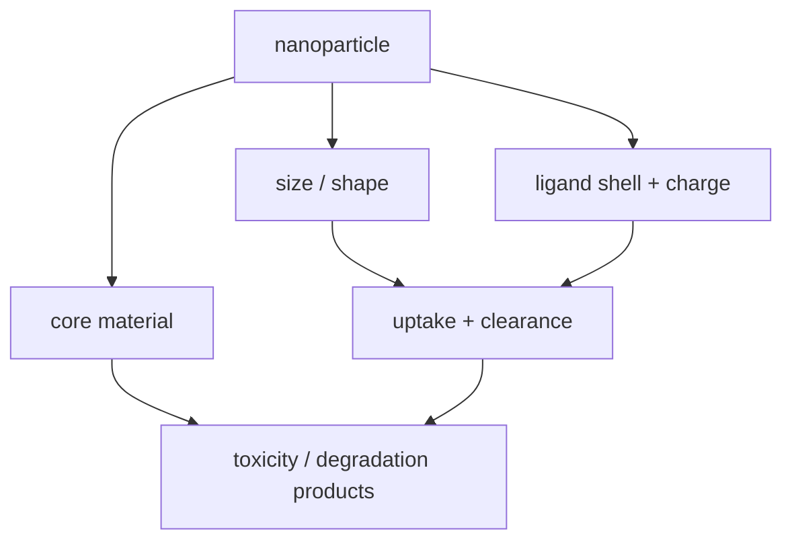

# Nanotoxicity

## In one paragraph
Nanotoxicity is the size-, material-, surface- and dose-dependent harm that nanomaterials can cause in biological systems. Lecture 7 requires ADME/Tox monitoring for nanocarriers, and lecture 13 explicitly names toxicity, clearance, biodegradability and size-dependent gold nanoparticle toxicity as biomedical constraints [L7, p.3; L13, pp.20–21].

## The design variables
A practical risk descriptor is qualitative rather than a single equation:

$$\mathrm{Risk}=f(\mathrm{dose},\mathrm{size},\mathrm{surface\ charge},\mathrm{material},\mathrm{clearance},\mathrm{degradation})$$

| Term | Meaning | Units / notes |
|---|---|---|
| dose | administered amount | mol L$^{-1}$, mg kg$^{-1}$ or particles mL$^{-1}$ |
| size | core and hydrodynamic diameter | nm |
| surface charge | effective charge or zeta potential | mV |
| material | Au, CuS, protein, DNA, oxide, semiconductor | composition-specific |
| clearance | removal by liver/kidney/cells | time scale or rate |
| degradation | breakdown of carrier/cargo | time scale or products |

Assumptions and validity limits: this is outside the lecture material as an organising expression, not a predictive toxicology model. The lecture does not provide numerical toxicity thresholds; it states size-dependent Au NP toxicity and general biomedical challenges [L13, pp.20–21].

*Takeaway: nanotoxicity is controlled by the same interface variables used to make nanocarriers functional [L7, p.3; L13, pp.20–21].*

## Typical orders of magnitude
- Relevant lengths are nm core sizes and hydrodynamic sizes; exact toxic size thresholds are not given in the lectures.
- Stable dispersions often have $|\zeta|>30$ mV, but biological compatibility depends on more than colloidal stability [L6, p.21; L13, pp.20–21].
- ADME/Tox means absorption, distribution, metabolism, excretion and toxicity must be monitored [L7, p.3].

## Connections
Related to [[nanoparticle-drug-delivery]], [[theranostics]], [[photothermal-therapy]], [[gold-nanoparticles]], [[surface-charge]], [[ligand-shell]] and [[protein-based-nanomedicine]].
