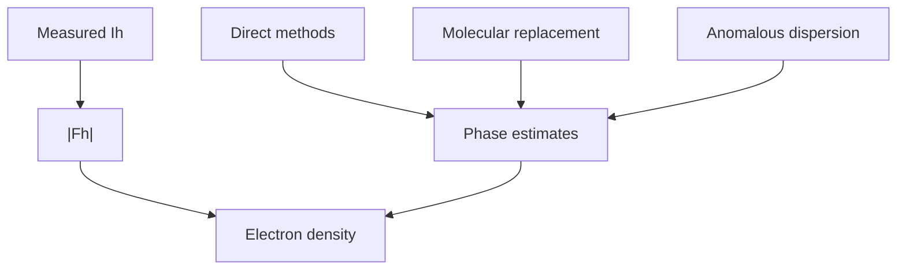

---
title: Phase Problem
type: concept
tags: [crystallography, phasing]
lectures: [L04]
updated: 2026-10-19
status: draft
---

# Phase Problem

The phase problem (Phasenproblem) is that electron-density reconstruction needs phases as well as amplitudes, but diffraction measures intensities [L4, p.1]. The notes state that phases are more important than amplitudes for recognising structures [L4, p.1].

$$\rho(\mathbf r)\propto\sum_h |F_h|\exp(i\phi_h)\exp(-2\pi i\mathbf h\cdot\mathbf r)$$

| Symbol | Meaning | Units / notes |
|---|---|---|
| $\rho(\mathbf r)$ | electron density | e Å$^{-3}$ |
| $|F_h|$ | measured amplitude | diffraction units |
| $\phi_h$ | missing phase | rad |
| $\mathbf h$ | reciprocal vector | Å$^{-1}$ |

*Takeaway: phasing methods supply information lost during intensity measurement.*

