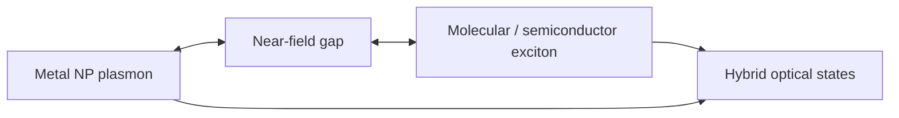

# Plasmon-Exciton Coupling

Plasmon-exciton coupling is the interaction between localized surface plasmons of metallic nanoparticles and excitons in semiconductor or organic molecular absorbers [L11, p.6]. The scan highlights that coupling forms new hybridized states with unusual optical characteristics and gives gold nanoparticles plus Rhodamine B as an example [L11, p.6].

*Takeaway: coupling requires spectral overlap and nanoscale proximity between plasmonic and excitonic components [L11, p.6].*

## Chemistry / physics
Hybrid mode splitting can be sketched by:

$$E_{\pm}=\frac{E_{\mathrm{pl}}+E_{\mathrm{ex}}}{2}\pm\sqrt{g^2+\Delta^2/4},\qquad \Delta=E_{\mathrm{pl}}-E_{\mathrm{ex}}$$

| Symbol | Meaning | Units / notes |
|---|---|---|
| $E_{\pm}$ | hybrid energies | eV |
| $E_{\mathrm{pl}}$ | plasmon resonance energy | eV |
| $E_{\mathrm{ex}}$ | exciton transition energy | eV |
| $g$ | coupling strength | eV |
| $\Delta$ | detuning | eV |

Assumptions and limits: outside-the-lecture model. The scan states the qualitative coupling; real spectra also depend on damping, orientation, distance and ensemble heterogeneity [L11, p.6].

## Biomedical link
Lecture 13 later uses plasmonic absorption in gold nanomaterials for photothermal therapy and diagnostics, where optical energy is coupled into local heating or signal generation [L13, pp.19–20].

