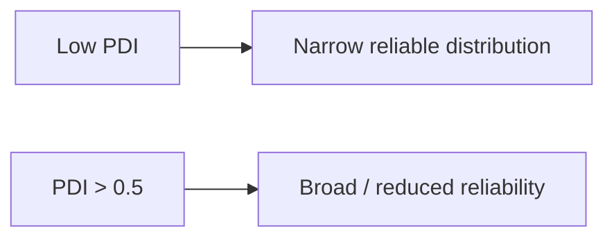

---
title: Polydispersity Index
type: concept
tags: [dls, size-distribution, quality-control]
lectures: [L06]
updated: 2026-10-19
status: draft
---

# Polydispersity Index

The polydispersity index (PDI) describes distribution breadth. In DLS, the notes give $\mathrm{PDI}=(\mathrm{standard\ deviation}/\mathrm{mean})^2$; in GPC, $\mathrm{PDI}=M_w/M_n$ [L6, p.17].

$$\mathrm{PDI}_{DLS}=\left(\frac{\sigma}{\mu}\right)^2,\qquad \mathrm{PDI}_{GPC}=\frac{M_w}{M_n}$$

| Symbol | Meaning | Units / notes |
|---|---|---|
| $\sigma$ | standard deviation | nm |
| $\mu$ | mean size | nm |
| $M_w,M_n$ | mass- and number-average molecular weights | g mol$^{-1}$ |

*Takeaway: high PDI reduces confidence in DLS size reporting [L6, p.17].*

