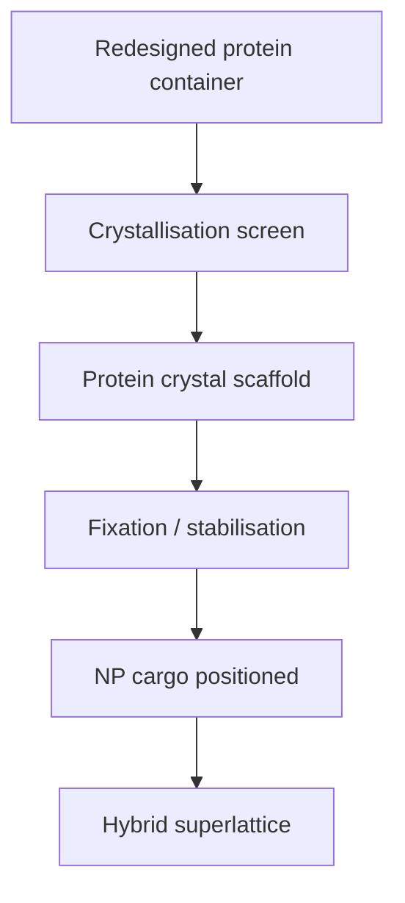

# Protein-Crystal Nanoparticle Superlattices

Protein-crystal nanoparticle superlattices are ordered hybrid materials where a protein scaffold determines the placement of nanoparticle cargo [L11, p.5]. In L11, redesigned protein containers are crystallised, fixed chemically if needed, and used to position NP cargo in periodic arrangements [L11, pp.3–5].

*Takeaway: the protein crystal supplies long-range order that nanoparticle synthesis alone usually lacks [L11, pp.3–5].*

## Order and unit-cell logic
The lecture asks how to describe the periodic arrangement of charged containers in 3D: long-range order means components repeat over large distances in a crystalline structure [L11, p.5]. A binary crystal can contain differently charged variants, producing multiple possible combinations and requiring characterisation by optical microscopy, SEM and EDX [L11, p.5].

## Chemistry / physics
The simplest lattice condition is Bragg diffraction:

$$2d\sin\theta=n\lambda$$

| Symbol | Meaning | Units / notes |
|---|---|---|
| $d$ | lattice-plane spacing | m or nm |
| $\theta$ | Bragg angle | degrees or rad |
| $n$ | diffraction order | dimensionless |
| $\lambda$ | probe wavelength | m or nm |

Assumptions and limits: this reuses the crystallography relation from [[bragg-law]] to express the lecture’s long-range-order point. It applies to periodic crystals; disordered aggregates will not give sharp Bragg peaks [L11, p.5].

## Links
Related to [[protein-crystals]], [[ferritin]], [[rosetta-protein-design]], [[nanoparticle-synthesis-in-nanoreactors]] and [[biohybrid-conductive-materials]].

