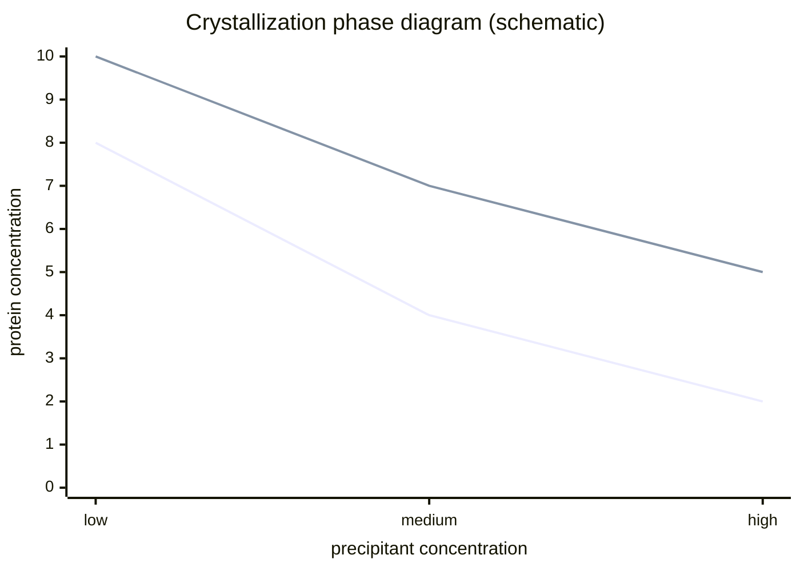

---
title: Protein Crystallization Phase Diagram
type: concept
tags: [crystallization, solubility, phase-diagram]
lectures: [L03]
updated: 2026-10-19
status: draft
---

# Protein Crystallization Phase Diagram

The lecture draws protein concentration versus precipitant concentration with nucleation, solubility, metastable, unstable/precipitation and homogeneous nucleation regions [L3, p.22]. Crystallisation seeks controlled supersaturation rather than amorphous precipitation.

*Takeaway: useful crystals form in a narrow window between undersaturation and precipitation.*

## Screening parameters
Protein concentration, pH value, salt concentration, precipitant type and drop size are varied in crystallisation/structural genomics screens; hanging-drop and sitting-drop methods are listed [L3, p.24].

## Links
Depends on [[salting-in-salting-out]], [[chaotropic-kosmotropic-ions]] and [[protein-crystals]].
