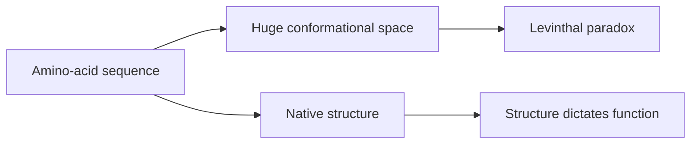

---
title: Protein Folding Problem
type: concept
tags: [protein-structure, folding, prediction]
lectures: [L04]
updated: 2026-10-19
status: draft
---

# Protein Folding Problem

Lecture 4 links the crystallography workflow to Levinthal's paradox: proteins fold within milliseconds into stable structures although exhaustive conformational search is impossible [L4, p.4].

*Takeaway: fast folding implies structured landscapes or learned constraints rather than random search.*

The lecture points to template-based modelling, [[alphafold]] and [[protein-mpnn]] as computational responses [L4, pp.4–5].

