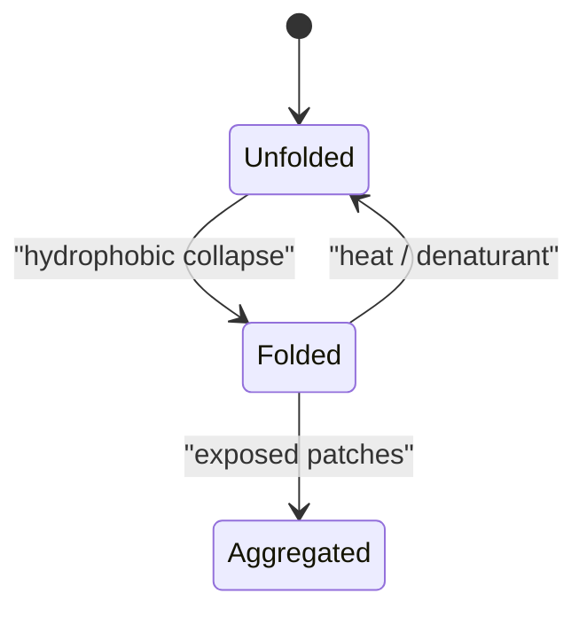

# Protein Folding Thermodynamics

The notes describe unfolded proteins as exposing hydrophobic residues to water, while folded proteins bury hydrophobic residues in a core [L1, p.3]. The [[hydrophobic-effect]] means hydrophobic molecules are surrounded by ordered water; aggregation or folding releases those waters and gives an entropic gain [L1, p.3]. Temperature denaturation reverses folding when the entropic term makes unfolding favourable.

$$
\Delta G = \Delta H - T\Delta S
$$

| Symbol | Meaning | Units |
|---|---|---|
| $\Delta G$ | folding free energy | kJ mol$^{-1}$ |
| $\Delta H$ | enthalpy from H-bonds, [[van-der-waals-interactions]] and electrostatics | kJ mol$^{-1}$ |
| $T$ | absolute temperature | K |
| $\Delta S$ | entropy change | J mol$^{-1}$ K$^{-1}$ |

*Takeaway: folding competes with denaturation and aggregation through free energy.*

## Limits
The scan treats folding schematically; real proteins may fold through intermediates and can aggregate irreversibly.

## Links
Introduced in [[L01]], revisited indirectly via solubility in [[L03]], [[salting-in-salting-out]] and [[chaotropic-kosmotropic-ions]].
