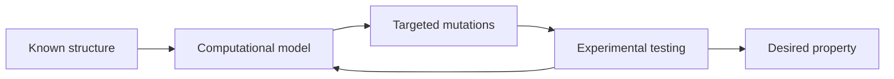

---
title: Rational Protein Design
type: concept
tags: [protein-design, modelling]
lectures: [L02]
updated: 2026-10-19
status: draft
---

# Rational Protein Design

Rational design uses existing knowledge of protein structure and function to design carriers or catalysts with specific properties and functionalities through computational modelling and targeted modifications [L2, p.9]. The notes contrast it with [[directed-evolution]], which searches variants experimentally.

*Takeaway: rational design is a hypothesis-driven loop from structure to mutation to function.*

## Validity limits
The notes explicitly state that computational methods are advanced but still improving and that experimental testing is still necessary [L2, p.10]. Accuracy is crucial when chemical bonds must form in enzyme design [L2, p.10].

## Links
Uses [[protein-structure]], [[enzyme-catalysis]], [[rosetta-protein-design]], [[green-fluorescent-protein]] and [[protein-cages]].
