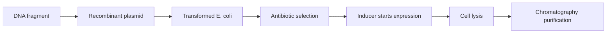

---
title: Recombinant Protein Production
type: concept
tags: [expression, e-coli, plasmid]
lectures: [L01]
updated: 2026-10-19
status: draft
---

# Recombinant Protein Production

The scan shows production in *E. coli*: a gene is inserted into a plasmid vector, cells are made competent with CaCl2/heat shock, transformed cells are selected by antibiotic resistance, expression is induced, cells are lysed, and the product is purified [L1, pp.5–6].

*Takeaway: recombinant production translates a designed gene into purified protein through cell culture and separation.*

## Parameters
- Cloning: gene of interest.
- Expression: protein production started with an inducer [L1, p.6].
- Harvesting: cells contain product intracellularly unless secretion/release is engineered [L1, p.6].
- Quality control: verification of product purity and identity [L1, p.6].

## Advantages and disadvantages from the notes
Advantages: cheap medium, easy gene/mutation introduction, rapid growth and high yields [L1, p.5]. Disadvantages: no eukaryotic folding machinery, no eukaryotic post-translational modifications, and eukaryotic proteins may require yeast/insect cells or more complex expression systems [L1, p.5].

## Links
Uses [[genetic-code-central-dogma]] and feeds [[affinity-chromatography]], [[ion-exchange-chromatography]], [[size-exclusion-chromatography]] and [[protein-crystallography]].
