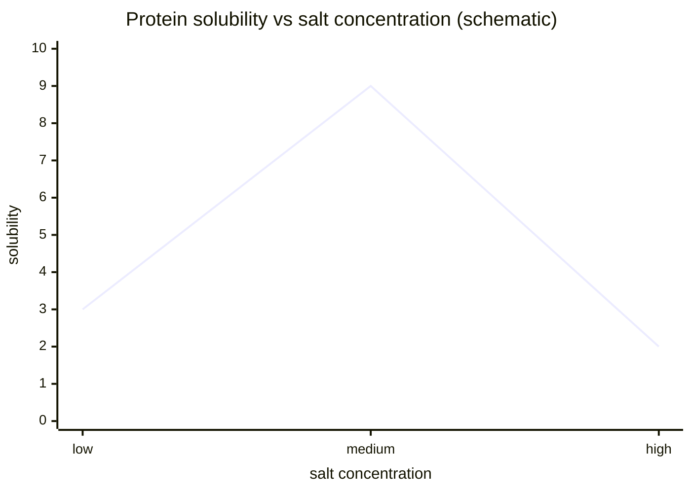

# Salting In and Salting Out

The notes distinguish salting in, where ions coordinate to proteins or shield charges to increase solubility, from salting out, where ions interact strongly with water, remove the hydration layer around proteins, expose hydrophobic patches through the [[hydrophobic-effect]] and induce aggregation [L3, p.23]. Ammonium sulfate precipitation is named as a standard purification step [L3, p.23].

*Takeaway: salts can first improve solubility and then drive aggregation/precipitation.*

## Validity limits
The lecture treats salt effects phenomenologically. Actual behaviour depends on protein [[surface-charge]], pH, [[isoelectric-point|pI]], salt identity and temperature.

## Links
Connected to [[protein-crystallization-phase-diagram]] and [[chaotropic-kosmotropic-ions]].
