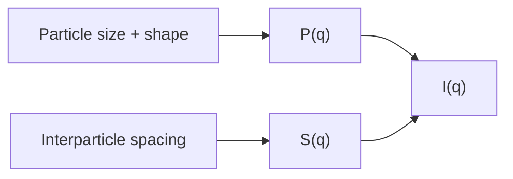

---
title: SAXS Form and Structure Factors
type: concept
tags: [saxs, form-factor, structure-factor]
lectures: [L06]
updated: 2026-10-19
status: draft
---

# SAXS Form and Structure Factors

Lecture 6 separates SAXS intensity into a form factor $P(q)$ and a structure factor $S(q)$ [L6, pp.22–25]. $P(q)$ depends on particle size and shape; $S(q)$ depends on arrangement, concentration, aggregation and assembly [L6, p.25].

$$I(q)\propto P(q)S(q)$$

| Symbol | Meaning | Units / notes |
|---|---|---|
| $I(q)$ | measured intensity | arbitrary units |
| $P(q)$ | form factor | size/shape |
| $S(q)$ | structure factor | interparticle order |

*Takeaway: SAXS curves combine particle geometry with collective order.*

A spacing estimate is $d\approx2\pi/q_{max}$ [L6, p.25].

