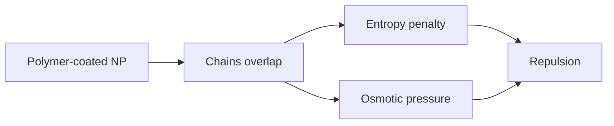

---
title: Steric Stabilization
type: concept
tags: [colloids, polymers, ligands]
lectures: [L05]
updated: 2026-10-19
status: draft
---

# Steric Stabilization

Steric stabilisation uses large adsorbed or grafted molecules as a physical barrier around particles [L5, p.10]. The lecture names entropic and osmotic repulsion mechanisms [L5, p.10].

*Takeaway: overlapping ligand shells create repulsive forces before particle cores touch.*

