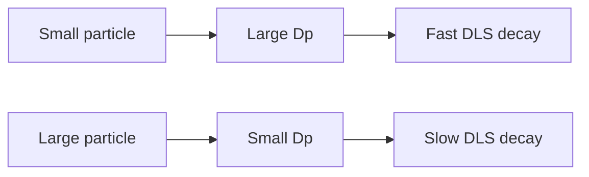

---
title: Stokes-Einstein Equation
type: concept
tags: [diffusion, viscosity, dls]
lectures: [L06]
updated: 2026-10-19
status: draft
---

# Stokes-Einstein Equation

The Stokes–Einstein equation connects diffusion to hydrodynamic diameter in DLS [L6, p.17].

$$D_p=\frac{k_BT}{3\pi\eta x_{h,t}}$$

| Symbol | Meaning | Units / notes |
|---|---|---|
| $D_p$ | particle diffusion coefficient | m$^2$ s$^{-1}$ |
| $k_B$ | Boltzmann constant | J K$^{-1}$ |
| $T$ | temperature | K |
| $\eta$ | dynamic viscosity | Pa s |
| $x_{h,t}$ | hydrodynamic diameter | m |

*Takeaway: hydrodynamic size is inversely proportional to diffusion coefficient.*

