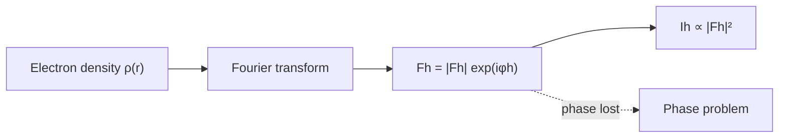

---
title: Structure Factor
type: concept
tags: [crystallography, fourier, phase]
lectures: [L04, L06]
updated: 2026-10-19
status: draft
---

# Structure Factor

The structure factor is the complex quantity assigned to a diffraction/scattering reflection. Lecture 4 writes $F_h=|F_h|\exp(i\phi_h)$ and states that intensity gives only $|F_h|^2$ [L4, p.1].

$$I_h \propto |F_h|^2$$

| Symbol | Meaning | Units / notes |
|---|---|---|
| $I_h$ | reflection intensity | detector counts |
| $F_h$ | complex structure factor | Fourier coefficient |
| $\phi_h$ | phase | rad or degrees |

*Takeaway: diffraction records amplitudes but not phases.*

In [[saxs-form-structure-factor]], the same word “structure factor” is used for interparticle arrangement rather than crystallographic phase [L6, p.25].

