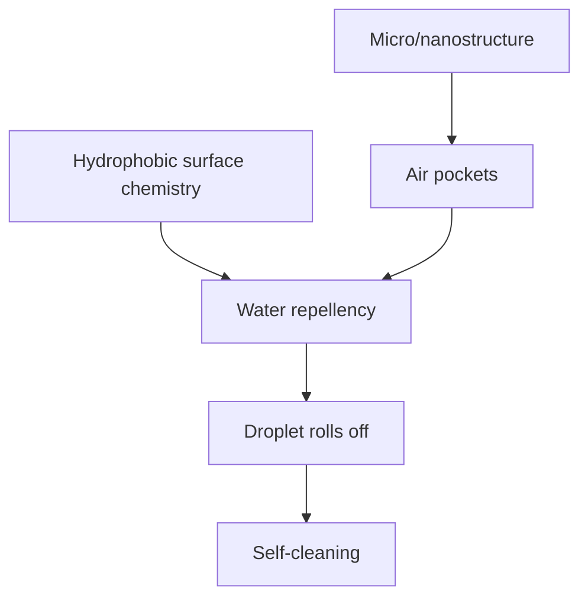

# Superhydrophobicity and the Lotus Effect

Superhydrophobic surfaces show very high water repellency because surface chemistry and micro/nanoscale roughness trap air beneath droplets [L12, p.8]. The lotus effect is the natural self-cleaning example: water droplets roll off, taking dirt and contaminants with them [L12, p.8].

*Takeaway: the lotus effect is not just chemical hydrophobicity; roughness amplifies it [L12, p.8].*

## Physics
The Cassie-Baxter relation describes a droplet on a composite solid/air surface:

$$\cos\theta^\*=f_s(\cos\theta+1)-1$$

| Symbol | Meaning | Units / notes |
|---|---|---|
| $\theta^\*$ | apparent contact angle | degrees |
| $\theta$ | flat-surface contact angle | degrees |
| $f_s$ | solid area fraction under droplet | dimensionless |

Assumptions and limits: outside-the-lecture equation. It assumes trapped air pockets and no impregnation of the roughness by water. The lecture also points to artificial silicon-wax lotus-effect coatings and microstructuring by bubbling agents [L12, p.8].

## Links
Connects [[biohybrid-materials]] to [[self-assembled-monolayers]], [[langmuir-blodgett-films]] and surface nanostructuring in [[L12]].

