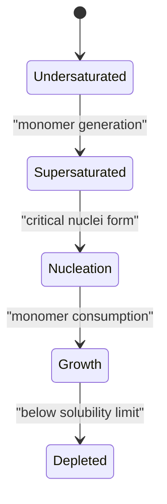

# Supersaturation

## In one paragraph
Supersaturation is the condition where dissolved monomer or solute concentration exceeds its equilibrium solubility. Lecture 5 places it between monomer generation and nucleation in nanoparticle growth, and lecture 9 uses it as a biological control variable for mineral nucleation and growth [L5, p.6; L9, pp.12–13].

## The physics
A common dimensionless definition is:

$$S=\frac{c}{c_{\mathrm{eq}}},\qquad \Delta\mu=k_BT\ln S$$

| Symbol | Meaning | Units / notes |
|---|---|---|
| $S$ | supersaturation ratio | dimensionless; $S>1$ supersaturated |
| $c$ | actual solute/monomer concentration | mol L$^{-1}$ |
| $c_{\mathrm{eq}}$ | equilibrium solubility | mol L$^{-1}$ |
| $\Delta\mu$ | chemical-potential driving force per molecule | J |
| $k_B$ | Boltzmann constant | J K$^{-1}$ |
| $T$ | temperature | K |

Assumptions and validity limits: the $\Delta\mu$ relation is outside the lecture material and assumes an ideal dilute solution. The scans ground supersaturation as the trigger for nucleation/growth and record $J_W=kS^x$ as a growth-rate expression [L5, p.6; L9, p.12].

*Takeaway: supersaturation should be high enough for nucleation but then depleted for controlled growth [L5, p.6].*

## Typical orders of magnitude
- Concentrations are expressed as mol L$^{-1}$; the lecture does not give numeric monomer concentrations.
- Growth-rate dependence $J_W=kS^x$ is lecture-level and empirical [L9, p.12].
- Separating a short nucleation burst from later growth narrows particle-size distributions [L5, p.6].

## Connections
Connects [[nanoparticle-growth]], [[classical-nucleation-theory]], [[controlled-nucleation-growth]], [[biomineralization]], [[surface-energy]] and [[protein-crystallization-phase-diagram]].
